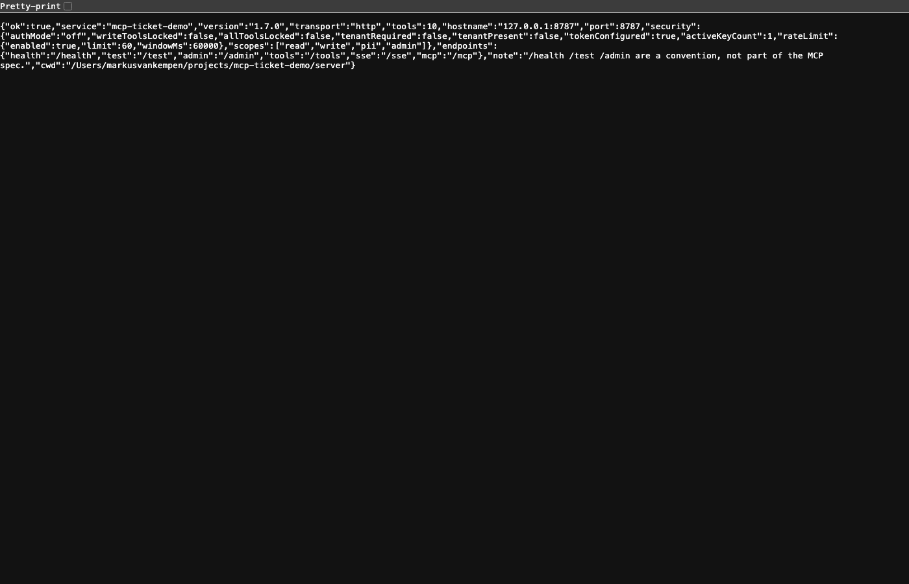
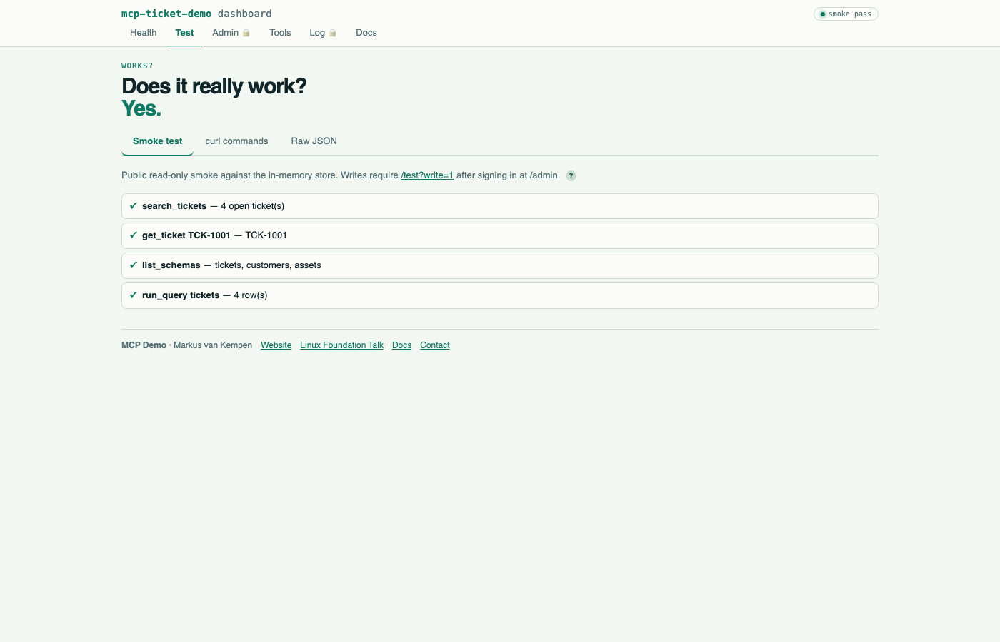

# MCP Reference Server — A Full-Stack MCP Demo

[](https://www.npmjs.com/package/mcp-reference-server)
[](https://modelcontextprotocol.io/)
[](https://modelcontextprotocol.io/specification/2025-11-25)
[](server/README.md#specifications-and-the-sep-control-plane)
[](server/README.md)
[](https://nodejs.org/)
[](LICENSE)

A **reference MCP server** for the [Model Context Protocol](https://modelcontextprotocol.io/). Use it to **check, validate and test** your client, your server, and proposed protocol changes (**SEPs**, Specification Enhancement Proposals) against a running implementation. Run it in under five minutes.

- **Reference:** 22 tools, 3 resources, 5 prompts, three transports (stdio, SSE, Streamable HTTP), three auth modes, API keys, per-tool gates, rate limiting, and a desk for health, tools, admin, and the log.
- **Validate:** `/health` says the server is alive, `/test` says it works, and the automated suites exercise tools, auth, events, tasks and skills.
- **Test SEPs:** 15 specifications and SEP prototypes (groups, skills, tasks, events and more) sit behind live switches. Flip one and watch how your client copes. See the [SEP control plane](server/README.md#specifications-and-the-sep-control-plane).

| | |
|---|---|
| **MCP server** (**mcp-reference-server 1.0.0**) | [`server/`](server/README.md) |
| **MCP specification and SEPs** | [modelcontextprotocol.io](https://modelcontextprotocol.io/) · [SEP process](https://modelcontextprotocol.io/community/sep-guidelines) |

Personal open-source project. SEP behavior here is a prototype for testing, not the specification; the specification at modelcontextprotocol.io is authoritative.

---

## What makes this useful beyond a hello-world

Most MCP examples stop at "here is a tool that returns a string." This one goes further:

| Feature | What you learn |
|---|---|
| **22 tools with intent-named descriptions** | Nouns live in a schema, verbs stay as tools — not `request(path, method)` |
| **3 resources** (`ticket://`, `tickets://open`, `schema://`) | `resources/list` enumerates instances; reads use the same `gate()` as the matching tool |
| **5 MCP prompts** | User-facing prompts vs agent-facing tools |
| **Tool annotations** (`readOnlyHint`, `destructiveHint`, `idempotentHint`, `openWorldHint: false`) | Client confirm/retry UX |
| **Server instructions** | The README the model actually reads |
| **`isError: true` on every failure** | Clients don't need to parse `ok: false` |
| **Attribution scar** — `create_ticket` without `requester_email` | 201 is not done. The bot owns the ticket. |
| **Schema discovery** — `get_schema → run_query` | One query tool beats a pile of `query_*` names |
| **0 tools discovered** — hand a laptop path to a cloud runner | The silent failure with no error and no warning |
| **stdio + SSE + Streamable HTTP** from one codebase | Three transports, same 22 tools |
| **Auth modes** (`off` / `write` / `all`) + per-tool gate + per-tool auth lock | Security is an operator concern |
| **`tools/list_changed` broadcast** when admin flips a gate | SSE **and** Streamable HTTP sessions refresh; one-shot curl does not |
| **Rate limiting** with `retry_after_seconds` in the error | Stop the model retrying in a loop |
| **PII redaction** on `run_query` `schema=customers` | Same tool, same endpoint; the `phone` field is `REDACTED` without the `pii` scope |
| **`/health` vs `/test`** | Alive ≠ works. Public `/test` is read-only; `cwd` stays off public `/health` |
| **Live observability** — `/log` page with counters, error log, call trace | See what the model is actually doing |
| **Operate it over MCP** — settings (one `update_settings` patch), users, API keys and settings import are tools, settings export is `run_query schema=settings`, and most need the `admin` scope even when auth is `off` | The control plane is part of the server, not a side door |
| **Three ways to operate one server** — `/admin` Remote config and the `mcp-reference-server` command line | Same steps, same Demo setup, checked against each other |
| **Groups** (**mcp-reference-server 1.0.0**) | Prototype of `io.modelcontextprotocol/groups`. A client that negotiates it gets `describe_server` and `get_schema` from `tools/list`, then `groups/list` and `groups/get`. Seven groups: query, tickets-write, admin, events, traffic, jobs, client. A client that does not negotiate still gets all 22 tools. [server/README.md](server/README.md#groups-prototype) |
| **Skills** (SEP-2640) | `io.modelcontextprotocol/skills`. A skill is a workflow and files (`skills/list`, `skills/get`, `resources/read`), not a tool and not a scope. Built in: `work-an-open-ticket`, `open-a-ticket`, `read-the-queue`. Admins upload more. [server/README.md](server/README.md#skills) |
| **Tasks** (SEP-2663) | `io.modelcontextprotocol/tasks`. `create_ticket` and `run_test_job` can return a flat task handle. Poll `tasks/get`, or open `tasks/stream` (SEP-2694, draft) and resume with `after`. After `ttlMs`, `tasks/get` is `-32602` with `data.status` `expired` until the retain window ends. `tasks/result` is not implemented. [server/README.md](server/README.md#tasks) |
| **Events** (SEP-3415 draft) | `io.modelcontextprotocol/events`. `events/list` and `events/poll` read the same bus as `GET /sse`. `events/stream` is a short push. Webhook is not offered. [server/README.md](server/README.md#events-extension) |
| **Sampling, roots, and progress** | `draft_reply` calls `sampling/createMessage` and does not post the draft. `list_workspace_roots` calls `roots/list` and does not read the files. An open `run_test_job` sends `notifications/progress` when the request carries a `progressToken`. A one-shot call has no client to ask. [server/README.md](server/README.md#asking-the-connected-client) |
| **Live SEP control plane** (`/admin#adm-seps`) | Toggle 15 MCP specifications & SEPs live (`2026-07-28 §2.1`, `SEP-1686`, `SEP-2640`, `SEP-2575`, `SEP-2567`, `SEP-2127`, `SEP-3415`, `SEP-3313`, `SEP-19`, `SEP-2636`, `SEP-1577`, `SEP-1036`, `SEP-1850`, `SEP-2549`, `SEP-2164`) to test client resilience and audit compliance. [server/README.md](server/README.md#specifications-and-the-sep-control-plane) lists what each switch changes |

---

## Quickstart — five minutes

```bash
# Run directly from npm — nothing to clone or install
npx mcp-reference-server           # stdio (IDE spawns this)
MCP_MODE=http npx mcp-reference-server  # HTTP — opens /health /test /admin /mcp
```

Then open in a browser:

| URL | What it shows |
|---|---|
| http://127.0.0.1:8787/health | Is the process alive? (`cwd` only on localhost) |
| http://127.0.0.1:8787/test | Read-only smoke: seed tickets, schemas, and `run_query` |
| http://127.0.0.1:8787/admin | Auth mode, API keys, tool gates, observability |
| http://127.0.0.1:8787/log | Call counters, error log, full call trace |
| http://127.0.0.1:8787/tools | Every tool, with its scope, a Try button, and the curl that calls it. Tabs for groups, skills, tasks, and the test job |
| http://127.0.0.1:8787/help#help-specs | Reference for the groups, skills, tasks, and events extensions |

### From a terminal

The same `mcp-reference-server` command is also a client for a running server, local or deployed. With no arguments it is still the MCP server, so the IDE configs below keep working.

```bash
npx mcp-reference-server status                                    # http://127.0.0.1:8787/mcp by default
npx mcp-reference-server call run_query schema=tickets 'filter={"status":"open"}' limit=5   # any tool, values typed from its schema
npx mcp-reference-server demo apply --user demo --password demo    # users, keys, auth write, 30 calls / 60 s
npx mcp-reference-server demo check --user demo --password demo    # acts as each role and as nobody
npx mcp-reference-server status --url https://my-host.example.com  # a deployed server
```

`--json` prints one document for scripts, and exit codes are `0` done · `1` refused · `2` usage · `3` unreachable. Commands that delete or reconfigure ask first. Every command, option and example is in [server/README.md](server/README.md#command-line), and a copy-paste page is at `/clients/cli.html` on a running desk. `demo apply` changes real settings, so use it on a server you own.





Laptop login: `demo` / `demo`. On a public bind (`HOST=0.0.0.0`, container, Code Engine) set `ADMIN_PASSWORD` — the default is disabled. Write smoke is `/test?write=1` after admin sign-in.

---

## Add to your IDE (one line)

**VS Code / GitHub Copilot** — `.vscode/mcp.json`:
```json
{
  "servers": {
    "mcp-reference-server": {
      "type": "stdio",
      "command": "npx",
      "args": ["mcp-reference-server"],
      "env": { "MCP_MODE": "stdio" }
    }
  }
}
```

**Bob / Cursor / Windsurf** — `.bob/mcp.json` / `.cursor/mcp.json` / `.windsurf/mcp.json`:
```json
{
  "mcpServers": {
    "mcp-reference-server": {
      "command": "npx",
      "args": ["mcp-reference-server"],
      "env": { "MCP_MODE": "stdio" }
    }
  }
}
```

Per-client detail is in [docs/LOCAL.md](docs/LOCAL.md) and [docs/BOB.md](docs/BOB.md), and a running desk serves copy-paste pages for each client at `/clients/`.

---

## Tools

The server has 22 tools. Six are the ticket desk, below. Eight operate the server itself: `update_settings` (every setting is one patch: auth mode, rate limit, call trace, desk sign-in, SEPs, transports, events, gates, locks and scopes), `set_mqtt`, users (`create_user`, `delete_user`), API keys (`issue_api_key`, `revoke_api_key`), `import_settings` and sample traffic (`generate_traffic`). Most of those need the `admin` scope even while auth is `off`; [server/README.md](server/README.md#operating-the-server) lists the scope of each. Three are timers, `start_timer`, `stop_timer` and `push_timer`, with no `get_timer` (`push_timer` also streams the timer as events; see [Events](server/README.md#events)): you read a timer through the schema, `run_query` with `schema=timers` ([server/README.md](server/README.md#timers)). `push_log` sends a log line as an event, and `watch_system` publishes the machine as `system.info`, including a container's cgroup limit. `run_test_job` waits a set time and ends as a chosen task status, to test long-running calls and SEP-2663 tasks ([server/README.md](server/README.md#a-test-job-for-every-task-status)). On an open call it also sends `notifications/progress` when the request carries a `progressToken`. `draft_reply` asks the connected client's model for a draft and does not post it. `list_workspace_roots` returns the workspace roots the client chose to share and does not read the files ([server/README.md](server/README.md#asking-the-connected-client)). Plain lists are not tools of their own: `run_query` reads `settings` (the saved settings, importable as they are), `system` (the machine), `events` (the events already sent), and, with an admin credential, `users`, `api_keys`, `trace`, `errors` and `counters`. The page at `/clients/dashboard.html` draws them. Each of these tools is declared once and everything else is generated from that definition.

### The ticket desk (6)

| Tool | Scope | When to use | Lesson |
|---|---|---|---|
| `describe_server` | `read` | First call, and after any denial | Discovery beats guessing |
| `create_ticket` | `write` | Open a ticket — **always pass `requester_email`** | Omit it → 201 + bot owns the ticket |
| `add_comment` | `write` | Comment on a known ticket | Write tool; gated |
| `close_ticket` | `write` | Resolve a ticket, optionally add resolution note | `destructiveHint: true, idempotentHint: true` |
| `get_schema` | `read` | Before any query | No `name` lists every name with its kind (`data`, `query`, `tool`); a `name` gives that shape or those arguments |
| `run_query` | `read` | The one query tool: `schema=tickets` (find by `status` / `requester_email` / `query`, or one ticket by `id` with body and comments), `schema=customers` (phone is `REDACTED` without the `pii` scope), plus `assets`, `timers`, `system`, `settings`, `events` (and, for an admin, `users`, `api_keys`, `trace`, `errors`, `counters`) | Nouns in a schema, verbs as tools. Replaces `query_tickets` / `query_assets` / … |

---

## 3 Resources

Resources are **addressable and pinnable** — clients can subscribe and refresh. Tools are for agent loops.

| URI | What it returns | Same gate as |
|---|---|---|
| `ticket://TCK-1001` | One ticket by id | `run_query` |
| `tickets://open` | Live open ticket list (top 25) | `run_query` |
| `schema://tickets` | Query schema shape (also `customers`, `assets`) | `get_schema` |

Call `resources/list` to browse — you do not need to know a URI ahead of time. A denied read is a JSON-RPC error (not a fake ticket document you can pin).

---

## 5 Prompts

User-facing prompts — the **user** picks these, the model executes them.

| Prompt | Lesson it teaches |
|---|---|
| `search-open-tickets` | List open tickets and who owns each one |
| `attribution-scar` | Create a ticket with no requester email. The service account owns it |
| `schema-discovery` | `get_schema` (no name) → `get_schema` (name) → `run_query` walkthrough |
| `close-ticket-flow` | `add_comment` then `close_ticket` in sequence |
| `diagnose-server` | `describe_server` — auth mode, scopes, available tools |

---

## Auth model

```
off    All tools open. No credential needed. Default for local dev.
write  Read tools open. Write tools need a credential. The customer phone shows only with a `pii` credential.
all    Every tool call requires a credential.
```

Credentials: `Authorization: Bearer <api key>` over HTTP · `MCP_API_KEY` env var over stdio.

Issue keys, set modes, toggle per-tool gates, and lock individual tools on `/admin`.
A change broadcasts `notifications/tools/list_changed` to connected SSE and Streamable HTTP sessions (Cursor/Bob after `initialize`). One-shot `POST /mcp` (curl) has no session — it sees the new list on the next call.

---

## Repo layout

```
mcp-reference-server/
  server/       MCP server — tools, resources, prompts, auth, HTTP pages
    src/cli/    The command line client (mcp-reference-server <command>)
    clients/    Copy-paste setup pages served at /clients/ (editors, browser, CLI, settings)
  docs/         Walkthroughs: demo, local, admin and security, Bob
  Dockerfile    node:20-bookworm-slim, non-root USER node, WORKDIR /app
```

---

## Docs

| Doc | What's in it |
|---|---|
| [docs/README.md](docs/README.md) | Index. Server **mcp-reference-server 1.0.0** |
| [docs/DEMO.md](docs/DEMO.md) | **End-to-end demo guide** — 16 live curl demos, every lesson, real captured output |
| [docs/LOCAL.md](docs/LOCAL.md) | Local stdio + HTTP walkthrough |
| [docs/ADMIN-AND-SECURITY.md](docs/ADMIN-AND-SECURITY.md) | Auth modes, API keys, tool gates, SEP switches |
| [docs/BOB.md](docs/BOB.md) | IBM Bob specific setup |
| [server/README.md](server/README.md) | Full reference: the 22 tools, groups, skills, tasks, sampling, roots, progress, every endpoint curl, and the command line |

---

## Environment variables

| Variable | Default | What it does |
|---|---|---|
| `MCP_MODE` | `stdio` | `stdio` or `http` |
| `PORT` | `8080` | HTTP only. `npm run http` uses **8787** |
| `HOST` | `127.0.0.1` | `0.0.0.0` inside container (set automatically) |
| `AUTH_MODE` | `off` | `off` · `write` · `all` |
| `ADMIN_USER` / `ADMIN_PASSWORD` | `demo` / `demo` | `/admin` login. Default disabled on a public bind until `ADMIN_PASSWORD` is set |
| `CORS_ORIGINS` | unset | Extra `Origin` values allowed on `/mcp`. Localhost and same-host are always allowed |
| `API_KEY` / `API_KEY_SCOPES` | unset | Register one key at boot |
| `MCP_API_KEY` | unset | stdio credential. The command line client sends it as a bearer key |
| `MCP_USERNAME` / `MCP_PASSWORD` | unset | stdio basic auth. The command line client sends them as HTTP Basic |
| `MCP_URL` | `http://127.0.0.1:8787/mcp` | Command line client only: the server to talk to |
| `MCP_SKILLS_DIR` | `~/.mcp-reference-server/skills` | Uploaded skills. They survive a restart. Tickets do not |
| `MCP_TASK_TTL_MS` | `60000` | How long a task handle lives |
| `MCP_USERS` | unset | `"alice:secret:read,write"` extra logins |
| `RATE_LIMIT` / `RATE_LIMIT_WINDOW_MS` | `60` / `60000` | Calls per window per caller |
| `TENANT_ID` | unset | If set, writes need `x-tenant-id` header |

---

## Honest limits

- Tickets live in memory — a new container starts from seed data.
- Admin auth is a session cookie, not SSO. Cookie is `HttpOnly` (+ `Secure` on HTTPS).
- `/health` being green does not mean the ticket went to the right person.
- Public `/test` does not create or close tickets. Use `/test?write=1` after admin sign-in.
- Remote config and the command line change real settings (auth mode, users, keys, rate limit) on whatever server you point them at. Demo setup is for a server you own.

---

**Author:** Markus van Kempen ·
[github.com/markusvankempen](https://github.com/markusvankempen) ·
[markusvankempen.github.io](https://markusvankempen.github.io/) ·
[npm](https://www.npmjs.com/package/mcp-reference-server)
